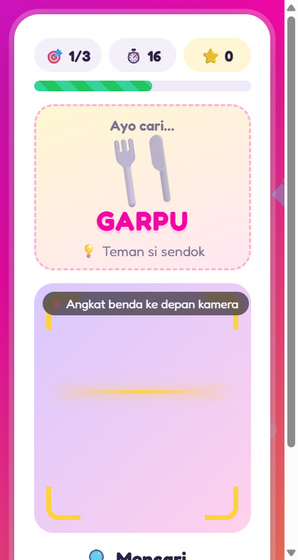

# 🕵️ Pemburu Benda

Pemburu Benda adalah game edukasi berbasis web untuk anak. Game memberi tantangan seperti "Cari **GELAS** dalam 30 detik!", lalu anak berkeliling rumah dan cukup **mengarahkan kamera** ke benda yang diminta. AI **Object Detection** (telkom_ai_dag di Apilogy) mengecek secara otomatis, tanpa perlu menekan tombol foto.

## 📸 Tampilan

| Layar Mulai | Saat Bermain |
|:---:|:---:|
|  |  |
| Pilih level dan jumlah ronde | Target benda, timer, skor, dan kamera yang terus memindai |

## ✨ Fitur

- **Deteksi benda real-time:** gambar dari kamera dikirim ke AI sekitar setiap 1 detik.
- **Main dari HP:** server HTTPS lokal dengan sertifikat buatan sendiri agar kamera browser HP bisa dipakai.
- **Mode cadangan:** jika kamera langsung tidak tersedia, game beralih ke tombol "Foto Sekarang".
- **Sistem skor:** 100 poin ditambah bonus dari sisa waktu.
- **Umpan balik AI:** jika benda salah, game menampilkan benda yang dilihat AI.
- **Aman:** API key hanya disimpan di server dan tidak pernah dikirim ke browser.

## 🛠️ Teknologi

| Bagian | Teknologi |
|---|---|
| Frontend | HTML, CSS, JavaScript (Vanilla), MediaDevices/Camera API |
| Backend | Node.js (tanpa framework), HTTP/HTTPS server |
| AI | Object Detection API — Telkom AI DAG via [Apilogy](https://apilogy.id) |

## 📁 Struktur Proyek

```
├── server.js          # Server HTTP/HTTPS + proxy ke API Object Detection
├── public/
│   ├── index.html     # Tampilan game
│   ├── game.js        # Logika game, kamera, timer, skor
│   ├── objects.js     # Daftar benda yang harus dicari
│   └── style.css
├── scripts/
│   └── make-cert.js   # Membuat sertifikat HTTPS lokal
└── .env.example       # Contoh konfigurasi
```

## 🚀 Cara menjalankan

1. Di apilogy.id, buka API **Object Detection** (by telkom_ai_dag), lalu klik **Pricing → Subscribe** pada Free Plan.
2. Buka **My Account → Applications → More → Details → Authentication Key → Key-Auth → Generate Key**, lalu salin key-nya.
3. Isi `APILOGY_API_KEY` di file `.env` (salin dari `.env.example` kalau belum ada).
4. Jalankan `npm start` (Node 20.12+), lalu buka http://localhost:3000 di laptop.

### Main dari HP (kamera langsung)

Browser HP hanya mengizinkan kamera langsung lewat **HTTPS**.

1. Jalankan sekali: `npm run cert` (membuat sertifikat di folder `certs/`; ulangi kalau IP laptop berubah).
2. Jalankan `npm start`. Terminal akan menampilkan alamat seperti `https://192.168.1.12:3443`.
3. Buka alamat itu di HP yang tersambung ke Wi-Fi yang sama. Kalau muncul peringatan *Not secure / Tidak aman*, pilih **Advanced → Proceed / Lanjutkan**. Peringatan ini normal karena sertifikatnya buatan sendiri.
4. Izinkan akses kamera.

Kalau kamera langsung tidak bisa dibuka, game otomatis beralih ke tombol **📷 Foto Sekarang**.

API key hanya disimpan di server (`server.js`) dan tidak pernah dikirim ke browser.

## Aturan

- Setiap ronde berdurasi 30 detik.
- **Mode kamera langsung:** AI mengecek gambar kamera sekitar setiap 1 detik sampai benda ditemukan.
- **Mode foto (cadangan):** timer berhenti selama AI memeriksa foto.
- Jika benda benar, pemain mendapat 100 poin ditambah 10 × sisa detik.
- Jika salah, game menampilkan benda yang dilihat AI (misalnya "AI melihat: kursi, botol"), lalu pemain terus mencari.

## Mengubah daftar benda

Edit `public/objects.js`. Nilai `label` harus salah satu dari 80 label yang didukung API, misalnya `cup`, `chair`, `teddy bear`, atau `cell phone`.

## Pengaturan `.env`

| Variabel | Fungsi |
|---|---|
| `APILOGY_API_KEY` | API key dari Apilogy |
| `OBJECT_DETECTION_URL` | Endpoint deteksi |
| `CONF_THRES` | Minimal keyakinan AI (0–1). Turunkan, misalnya ke `0.2`, kalau benda sering tidak terdeteksi |
| `HTTPS_PORT` | Port HTTPS untuk HP (default `3443`) |
| `DEBUG=1` | Menampilkan response mentah API di terminal |

