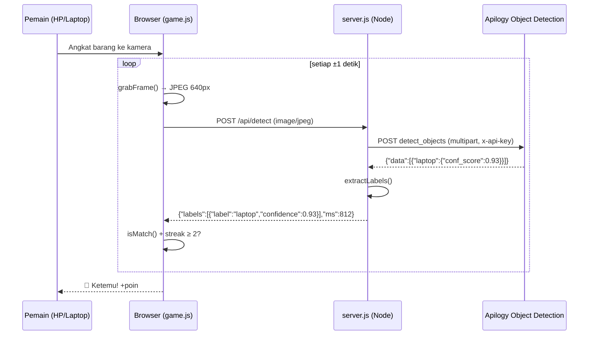
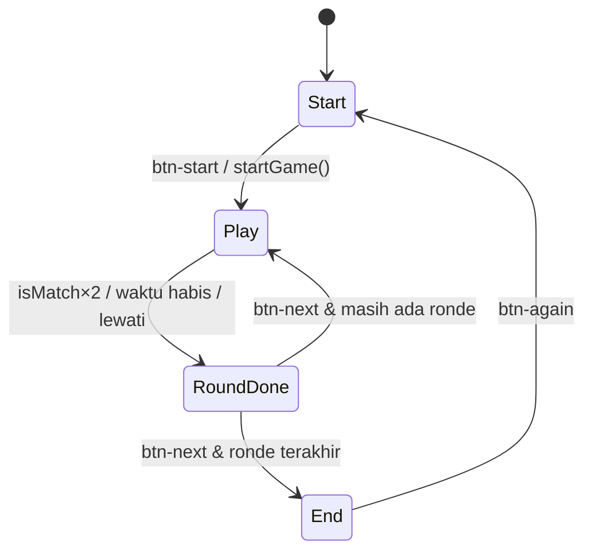

# IMPLEMENTATION — Pemburu Benda: Edisi Kampus

Dokumen ini menjelaskan **cara game dibangun**, file demi file dan fungsi demi fungsi. Isinya cukup lengkap untuk membangun ulang game dari nol atau untuk mengembangkannya. Kebutuhan produk ada di [PRD.md](PRD.md).

---

## Daftar Isi
1. [Gambaran Arsitektur](#1-gambaran-arsitektur)
2. [Teknologi & Prasyarat](#2-teknologi--prasyarat)
3. [Struktur Folder](#3-struktur-folder)
4. [Konfigurasi](#4-konfigurasi)
5. [Backend — server.js](#5-backend--serverjs)
6. [Kontrak API Internal](#6-kontrak-api-internal)
7. [Database Barang — public/objects.js](#7-database-barang--publicobjectsjs)
8. [Frontend — public/index.html](#8-frontend--publicindexhtml)
9. [Logika Game — public/game.js](#9-logika-game--publicgamejs)
10. [Tampilan — public/style.css](#10-tampilan--publicstylecss)
11. [HTTPS Lokal — scripts/make-cert.js](#11-https-lokal--scriptsmake-certjs)
12. [Menjalankan di Kelas](#12-menjalankan-di-kelas)
13. [Pengujian](#13-pengujian)
14. [Keamanan & Privasi](#14-keamanan--privasi)
15. [Troubleshooting](#15-troubleshooting)
16. [Cara Mengembangkan](#16-cara-mengembangkan)
17. [Lampiran: 80 Label COCO](#17-lampiran-80-label-coco)

---

## 1. Gambaran Arsitektur



Prinsip desain:
- **Proxy backend.** Browser tidak pernah memanggil Apilogy langsung, jadi API key tetap rahasia.
- **Tanpa framework dan tanpa dependency.** Cukup `node server.js`. Mudah dipelajari di workshop.
- **Stateless.** Server tidak menyimpan data. Semua state permainan ada di memori browser.

## 2. Teknologi & Prasyarat

| Bagian | Teknologi | Alasan |
|---|---|---|
| Runtime | Node.js **≥ 20.12** | Punya `fetch`, `FormData`, `Blob`, `AbortSignal.timeout`, dan `process.loadEnvFile` bawaan |
| Server | Modul `node:http` & `node:https` | Tanpa Express, nol dependency |
| Frontend | HTML + CSS + JavaScript vanilla | Tanpa proses build |
| Kamera | `navigator.mediaDevices.getUserMedia` | Video langsung |
| Gambar | `<canvas>` → `toBlob('image/jpeg', 0.8)` | Memperkecil ukuran sebelum upload |
| Suara | Web Audio API (`OscillatorNode`) | Tanpa file audio |
| Font | Google Fonts "Fredoka" | Tampilan ramah dan membulat |
| AI | Telkom AI DAG Object Detection v0.0.2 (model COCO 80 kelas) | Free Plan di Apilogy |
| Sertifikat | OpenSSL (ikut Git for Windows) | HTTPS lokal agar kamera bisa dibuka di HP |

## 3. Struktur Folder

```
pemburu-benda/
├── package.json            # script start & cert, engines node>=20.12
├── server.js               # HTTP/HTTPS server + proxy /api/detect
├── .env.example            # template konfigurasi (disalin ke .env)
├── .gitignore              # node_modules/, .env, certs/, *.pem, *.log
├── README.md
├── docs/
│   ├── PRD.md
│   ├── IMPLEMENTATION.md   # dokumen ini
│   └── PROMPT-ONE-SHOT.md
├── public/                 # semua file yang dikirim ke browser
│   ├── index.html          # 3 layar: mulai, main, selesai
│   ├── style.css
│   ├── objects.js          # DATABASE barang + alias + terjemahan label
│   └── game.js             # seluruh logika game
└── scripts/
    └── make-cert.js        # membuat certs/key.pem & certs/cert.pem
```

### package.json

```json
{
  "name": "pemburu-benda",
  "version": "2.0.0",
  "private": true,
  "description": "Game mencari benda di kelas dengan Object Detection (Apilogy)",
  "main": "server.js",
  "scripts": {
    "start": "node server.js",
    "cert": "node scripts/make-cert.js"
  },
  "engines": { "node": ">=20.12" }
}
```

## 4. Konfigurasi

File `.env` dibaca dengan `process.loadEnvFile()` jika file tersebut ada.

| Variabel | Default | Fungsi |
|---|---|---|
| `APILOGY_API_KEY` | *(kosong)* | **Wajib.** Key dari Apilogy (My Account → Applications → Details → Key-Auth → Generate Key) |
| `OBJECT_DETECTION_URL` | `https://telkom-ai-dag.api.apilogy.id/Object_Detection/0.0.2/images/detect_objects` | Endpoint deteksi |
| `CONF_THRES` | `0.45` | Ambang keyakinan di sisi API. Turunkan (misalnya `0.3`) jika kelas redup |
| `PORT` | `3000` | Port HTTP |
| `HTTPS_PORT` | `3443` | Port HTTPS, hanya aktif jika `certs/` ada |
| `DEBUG` | *(kosong)* | Isi `1` untuk mencetak respons mentah API ke terminal |

`.env.example`:
```
APILOGY_API_KEY=
OBJECT_DETECTION_URL=https://telkom-ai-dag.api.apilogy.id/Object_Detection/0.0.2/images/detect_objects
CONF_THRES=0.45
PORT=3000
HTTPS_PORT=3443
DEBUG=
```

## 5. Backend — server.js

### 5.1 Konstanta

| Nama | Nilai | Keterangan |
|---|---|---|
| `MAX_UPLOAD` | `8 * 1024 * 1024` | Batas ukuran body upload |
| `COCO` | `Set` berisi 80 label | Whitelist label yang boleh diteruskan ke klien |
| `PUBLIC_DIR` | `path.join(__dirname, 'public')` | Akar file statis |
| `MIME` | `.html`, `.js`, `.css` | Content-Type. Ekstensi lain memakai `application/octet-stream` |
| `CONF_KEYS` | `conf_score, confidence, score, conf, probability, prob` | Kandidat nama field confidence |

### 5.2 Fungsi

| Fungsi | Tanggung jawab |
|---|---|
| `sendJson(res, status, body)` | Menulis header `application/json; charset=utf-8` dan body JSON |
| `readBody(req)` | Mengumpulkan chunk menjadi `Buffer`. Jika total > `MAX_UPLOAD`, reject dengan `Foto terlalu besar` dan `req.destroy()` |
| `readConf(obj)` | Mengembalikan nilai numerik pertama dari `CONF_KEYS`, atau `null` |
| `addLabel(out, label, conf)` | Menyimpan confidence **tertinggi** per label di `Map` |
| `extractLabels(node, out)` | Menelusuri respons API secara rekursif (lihat 5.3) |
| `handleDetect(req, res)` | Validasi → bangun `FormData` → `fetch` ke Apilogy → petakan error → balas label |
| `serveStatic(req, res)` | Menyajikan file dari `public/` dengan pencegahan path traversal dan `Cache-Control: no-cache` |
| `handler(req, res)` | Router: `POST /api/detect`, `GET *` ke static, metode lain ke 405. Membungkus semua error menjadi JSON 500 |
| `lanAddresses()` | Daftar IPv4 non-internal untuk dicetak saat start |

### 5.3 Algoritma `extractLabels`

Bentuk respons Apilogy bisa berbeda-beda, jadi parser dibuat toleran:

```
extractLabels(node):
  jika string  → jika termasuk COCO, tambahkan (confidence null)
  jika array   → rekursi setiap elemen
  jika objek   →
     a) jika ada field label/name/class/class_name/object/category yang termasuk COCO
        → addLabel(field, readConf(node))
     b) untuk setiap key: jika key termasuk COCO → addLabel(key, readConf(value))
        lalu rekursi ke value
```

Contoh:
```json
{"data":[{"laptop":{"bbox":[12,40,600,420],"conf_score":0.93}},{"cup":{"bbox":[...],"conf_score":0.61}}]}
```
menghasilkan `[{label:"laptop",confidence:0.93},{label:"cup",confidence:0.61}]`.

`extractLabels` diekspor (`module.exports`) supaya bisa diuji tanpa menjalankan server.

### 5.4 `handleDetect` langkah demi langkah

1. Jika `API_KEY` kosong, balas **500** `APILOGY_API_KEY belum diisi di file .env`.
2. `buf = await readBody(req)`. Jika kosong, balas **400** `Foto kosong`.
3. `form.append('file', new Blob([buf], {type:'image/jpeg'}), 'photo.jpg')`.
4. `url.searchParams.set('conf_thres', CONF_THRES)`.
5. `fetch(url, { method:'POST', headers:{'x-api-key':API_KEY, Accept:'application/json'}, body: form, signal: AbortSignal.timeout(20000) })`.
6. Jika respons tidak OK, petakan errornya:
   - 401/403 → `API key ditolak. Cek APILOGY_API_KEY dan pastikan sudah subscribe Object Detection.`
   - 429 → `Terlalu banyak foto, tunggu sebentar ya.`
   - lainnya → `Object Detection error <status>`

   Balas **502** `{error, detail}`.
7. Jika OK, balas **200** `{labels, ms, raw}`.

Timeout (`TimeoutError`) ditangkap di `handler` lalu dibalas 500 `AI terlalu lama menjawab, coba lagi`.

### 5.5 Static server aman

```js
const urlPath = decodeURIComponent(new URL(req.url, 'http://x').pathname);
const file = path.normalize(path.join(PUBLIC_DIR, urlPath === '/' ? 'index.html' : urlPath));
if (!file.startsWith(PUBLIC_DIR)) → 403
```
Dengan cara ini, permintaan seperti `/../.env` tidak bisa keluar dari folder `public/`.

### 5.6 Start-up

- HTTP selalu jalan di `PORT`.
- Jika `certs/key.pem` dan `certs/cert.pem` ada, HTTPS juga jalan di `HTTPS_PORT`, dan terminal mencetak `https://<IP-LAN>:3443` untuk setiap IP.
- Jika sertifikat belum ada, terminal mencetak saran `npm run cert`.
- Blok start dibungkus `if (require.main === module)` supaya `require('./server')` di test tidak membuka port.

## 6. Kontrak API Internal

### `POST /api/detect`

| | |
|---|---|
| Request header | `Content-Type: image/jpeg` |
| Request body | Byte JPEG mentah (≤ 8 MB) |
| 200 | `{"labels":[{"label":"laptop","confidence":0.93}],"ms":812,"raw":{...}}` |
| 400 | `{"error":"Foto kosong"}` |
| 500 | `{"error":"APILOGY_API_KEY belum diisi di file .env"}` atau timeout/error lain |
| 502 | `{"error":"API key ditolak..."}` / `{"error":"Terlalu banyak foto..."}` |

`confidence` bisa bernilai `null` jika API tidak memberi skor. Klien menganggap `null` sebagai lolos.

## 7. Database Barang — public/objects.js

File ini mengisi tiga variabel global: `window.TARGETS`, `window.ALIASES`, dan `window.LABEL_ID`. File dimuat **sebelum** `game.js`.

### 7.1 Skema

| Field | Tipe | Wajib | Keterangan |
|---|---|---|---|
| `label` | string | salah satu dari `label`/`all` | Satu label COCO |
| `all` | string[] | salah satu dari `label`/`all` | Semua label harus terlihat **di frame yang sama** |
| `also` | string[] | tidak | Label lain yang juga dianggap benar (berlaku untuk setiap elemen yang diperiksa) |
| `name` | string | ya | Nama tampil Bahasa Indonesia |
| `emoji` | string | ya | 1–2 emoji |
| `hint` | string | ya | Petunjuk pendek dan santai |
| `level` | 1–4 | ya | 1 Mudah, 2 Sedang, 3 Sulit (kombinasi), 4 Nyeleneh |

### 7.2 Isi lengkap (Edisi Kampus)

```js
window.TARGETS = [
  // Level 1 — Mudah
  { label: 'cell phone', name: 'HP', emoji: '📱', hint: 'Yang lagi kamu pegang juga boleh 😏', level: 1 },
  { label: 'laptop', name: 'Laptop', emoji: '💻', hint: 'Buka setengah supaya layar & keyboard kelihatan', level: 1 },
  { label: 'bottle', name: 'Botol Minum', emoji: '🧴', hint: 'Tumbler, botol air mineral, atau botol teh', also: ['cup'], level: 1 },
  { label: 'book', name: 'Buku / Binder', emoji: '📖', hint: 'Buku catatan, binder, atau modul kuliah', level: 1 },
  { label: 'backpack', name: 'Tas Ransel', emoji: '🎒', hint: 'Angkat tasmu ke depan kamera', level: 1 },
  { label: 'mouse', name: 'Mouse', emoji: '🖱️', hint: 'Mouse wireless dari tas laptop', level: 1 },
  { label: 'cup', name: 'Tumbler / Gelas', emoji: '🥤', hint: 'Tumbler, gelas, atau cup minuman', level: 1 },
  { label: 'handbag', name: 'Tas Selempang / Tote', emoji: '👜', hint: 'Sling bag, tote bag, atau tas tangan', level: 1 },

  // Level 2 — Sedang
  { label: 'keyboard', name: 'Keyboard', emoji: '⌨️', hint: 'Keyboard eksternal atau keyboard laptop', level: 2 },
  { label: 'scissors', name: 'Gunting', emoji: '✂️', hint: 'Sisa tugas maket atau kliping', level: 2 },
  { label: 'umbrella', name: 'Payung', emoji: '☂️', hint: 'Payung lipat andalan musim hujan', level: 2 },
  { label: 'tie', name: 'Dasi', emoji: '👔', hint: 'Buat yang habis presentasi atau sidang', level: 2 },
  { label: 'remote', name: 'Pointer Presentasi', emoji: '🎛️', hint: 'Clicker / pointer untuk presentasi', level: 2 },
  { label: 'suitcase', name: 'Koper', emoji: '🧳', hint: 'Yang habis kelas langsung pulang kampung', level: 2 },

  // Level 3 — Sulit (dua barang sekaligus)
  { all: ['laptop', 'mouse'], name: 'Laptop + Mouse', emoji: '💻🖱️', hint: 'Setup nugas lengkap', level: 3 },
  { all: ['laptop', 'cell phone'], name: 'Laptop + HP', emoji: '💻📱', hint: 'Multitasking: Zoom sambil balas grup', level: 3 },
  { all: ['laptop', 'book'], name: 'Laptop + Buku', emoji: '💻📖', hint: 'Belajar hybrid', level: 3 },
  { all: ['laptop', 'cup'], name: 'Laptop + Tumbler', emoji: '💻🥤', hint: 'Nugas ala anak kafe', level: 3 },
  { all: ['backpack', 'laptop'], name: 'Ransel + Laptop', emoji: '🎒💻', hint: 'Isi wajib tas mahasiswa', level: 3 },
  { all: ['book', 'bottle'], name: 'Buku + Botol', emoji: '📖🧴', hint: 'Siap kuliah pagi', level: 3 },
  { all: ['backpack', 'bottle'], name: 'Ransel + Botol', emoji: '🎒🧴', hint: 'Siap berangkat ngampus', level: 3 },
  { all: ['cell phone', 'book'], name: 'HP + Buku', emoji: '📱📖', hint: 'Foto catatan teman sebelum ujian', level: 3 },
  { all: ['book', 'scissors'], name: 'Buku + Gunting', emoji: '📖✂️', hint: 'Tugas kliping dadakan', level: 3 },
  { all: ['backpack', 'umbrella'], name: 'Ransel + Payung', emoji: '🎒☂️', hint: 'Siap menembus hujan ke kampus', level: 3 },

  // Level 4 — Nyeleneh (banyak perlengkapan sekaligus)
  { all: ['backpack', 'laptop', 'cell phone', 'book', 'bottle'], name: 'Bongkar Isi Tas', emoji: '🎒💻📱📖🧴', hint: 'Keluarkan SEMUA: ransel, laptop, HP, buku, botol, tunjukkan barengan! 🤣', level: 4 },
  { all: ['tie', 'laptop', 'remote'], name: 'Gaya Sidang Skripsi', emoji: '👔💻🎛️', hint: 'Dasi + laptop + pointer. Latihan sidang dari sekarang 😎', level: 4 }
];

window.ALIASES = { cup: ['cup', 'wine glass'] };
```

`window.LABEL_ID` berisi terjemahan untuk ke-80 label (lihat [Lampiran](#17-lampiran-80-label-coco)).

### 7.3 Kenapa barang ini dipilih

- **Hanya perlengkapan mahasiswa.** Semuanya termasuk 80 kelas COCO, jadi bisa dikenali model.
- **Mudah**: barang yang ada di hampir setiap tas mahasiswa.
- **Sedang**: perlengkapan yang hanya dibawa sebagian orang (keyboard, gunting, payung, dasi, pointer, koper). Ini memancing interaksi antarteman, misalnya "Siapa yang bawa gunting?!"
- **Sulit**: kombinasi yang ceritanya relatable (nugas, kelas pagi, hujan, ujian).
- **Nyeleneh**: tetap perlengkapan mahasiswa, tapi 3–5 barang harus terlihat bersamaan, jadi pemain harus heboh membongkar tas atau berpose seperti sidang skripsi.
- **Sengaja tidak dipakai**: buah dan makanan (jarang dibawa dan sulit dideteksi), hewan, perabot besar (kulkas, kasur, dan sebagainya), kendaraan, serta `knife` (benda tajam).
- **Tidak bisa dipakai**: pulpen, pensil, penghapus, penggaris, stapler, charger, flashdisk, dan jam tangan. Model COCO **tidak punya** label untuk barang-barang itu.

## 8. Frontend — public/index.html

Satu halaman berisi tiga `<section class="screen">`. Hanya satu layar yang tampil dalam satu waktu (atribut `hidden`).

| ID / elemen | Fungsi |
|---|---|
| `.bg > span` ×8 | Emoji melayang dekoratif (`aria-hidden`) |
| `#screen-start` | Maskot, judul, `.choices[data-target=level]` (5 chip: 1, 2, 3, 4, 0), `#level` hidden, `.choices.small[data-target=rounds]` (3, 5, 10), `#rounds` hidden, `#btn-start` |
| `#screen-play` | HUD (`#round-no`, `#round-total`, `#time-left`, `#score`), `#timer-bar`, kartu target (`#target-emoji`, `#target`, `#hint`), `#cam-wrap` (`#video`, `#scan` dengan 4 sudut `<i>` + `.laser`, `.badge`, `#btn-flip`), `#preview`, `#btn-photo` + `#camera` (input file), `#status`, `#seen`, `#btn-next`, `#btn-skip` |
| `#screen-end` | `.trophy`, `.title`, `#stars`, `#final-score`, `#summary` (ul), `#btn-again` |
| `#confetti` | Wadah partikel konfeti |
| Script | `objects.js` lalu `game.js` (urutannya penting) |

Atribut penting pada `<video>`: `autoplay playsinline muted`. Tanpa `playsinline`, iOS akan membuka video layar penuh.

## 9. Logika Game — public/game.js

Seluruh kode dibungkus IIFE `(() => { ... })()` supaya tidak mengotori variabel global.

### 9.1 Konstanta

| Nama | Nilai | Arti |
|---|---|---|
| `ROUND_SECONDS` | 30 | Durasi ronde |
| `SCAN_GAP_MS` | 600 | Jeda setelah setiap respons sebelum scan berikutnya |
| `MIN_CONF` | 0.5 | Confidence minimum di klien |
| `CONFIRM_FRAMES` | 2 | Jumlah frame cocok berturut-turut |

### 9.2 State

```js
const state = {
  queue: [],      // daftar target permainan ini (sudah diacak & dipotong)
  index: 0,       // ronde aktif (0-based)
  score: 0,
  timeLeft: 0,
  timer: null,    // id setInterval
  checking: false,// sedang menunggu respons AI
  done: false,    // ronde aktif sudah selesai
  results: [],    // [{target, success, points}]
  live: false,    // true = kamera langsung, false = mode foto
  stream: null,   // MediaStream
  round: 0,       // token ronde, naik setiap startRound → menghentikan scanLoop lama
  streak: 0,      // frame cocok berturut-turut
  facing: 'environment' | 'user'
};
```

### 9.3 State machine



### 9.4 Fungsi utama

| Fungsi | Detail |
|---|---|
| `canLive()` | `isSecureContext && navigator.mediaDevices?.getUserMedia` |
| `shuffle(arr)` | Fisher–Yates, mengembalikan salinan |
| `show(screen)` | Mengatur `hidden` pada 3 section |
| `isMatch(labels, target)` | Lihat 9.5 |
| `describe(labels)` | Membuang `person`, menerjemahkan dengan `LABEL_ID`, menghapus duplikat, lalu membentuk "👀 AI melihat: …" atau "🤔 AI belum melihat benda apa pun." |
| `openStream(facing)` | `getUserMedia({video:{facingMode:{ideal:facing}, width:{ideal:1280}, height:{ideal:720}}, audio:false})` |
| `attachStream(stream, facing)` | Memasang stream ke `<video>`. Kamera depan diberi kelas `.mirror` (`transform: scaleX(-1)`) |
| `startCamera()` | Memakai `localStorage.facing` (default `environment`), lalu menampilkan `#btn-flip` jika ada ≥ 2 kamera. Mengembalikan `true/false` |
| `switchCamera()` | Menghentikan track, membuka kamera sebaliknya, dan jika gagal kembali ke kamera sebelumnya |
| `stopCamera()` | Menghentikan semua track |
| `startGame()` | `pool = level ? TARGETS.filter(level) : TARGETS` → `shuffle` → `slice(0, rounds)` → reset skor → `live = await startCamera()` → `show('play')` → `startRound()` |
| `startRound()` | `round++`, reset timer/streak/UI, isi kartu target, `setInterval(tick,1000)`, lalu jika `live` jalankan `scanLoop(round)` |
| `tick()` | Mode foto: timer berhenti saat `checking`. Mengurangi `timeLeft`, `renderTimer()`, dan jika ≤ 0 memanggil `endRound(false,'⏰ Waktu habis!')` |
| `renderTimer()` | Lebar bar = `timeLeft/30*100%`. Saat ≤ 10 detik: kelas `.warn` + `sound('tick')` |
| `sound(kind)` | Nada kotak/segitiga: `win` [523,659,784,1047], `lose` [392,330,262], `tick` [880], `start` [440,660] |
| `confetti()` | 80 elemen `<i>` dengan warna dan durasi acak, dihapus setelah 3,8 detik |
| `shake()` | Memasang ulang kelas `.shake` pada `.card` (reflow lewat `offsetWidth`) |
| `endRound(success, msg)` | Idempoten (`if done return`). Poin = `100 + timeLeft*10`. Mencatat ke `results`, menampilkan efek, dan mengganti tombol Lewati menjadi Lanjut |
| `nextRound()` / `endGame()` | Bintang: 3 = semua berhasil, 2 = ≥ 50%, 1 = ≥ 1, 0. Ringkasan diisi lewat `textContent` (aman dari XSS) |
| `drawToBlob(src,w,h,maxSide)` | Skala `min(1, maxSide/max(w,h))` → canvas → JPEG 0,8 |
| `grabFrame()` | Dari `<video>`, `maxSide` 640 |
| `resizeImage(file)` | Dari file input, `maxSide` 1024 |
| `detect(blob)` | `fetch('/api/detect', {method:'POST', headers:{'Content-Type':'image/jpeg'}, body: blob})`. Jika gagal, melempar `Error` dengan `.status` |
| `scanLoop(round)` | Lihat 9.6 |
| `onPhoto(e)` | Mode cadangan: resize → preview → detect → cocok? `endRound(true)` : "😅 Belum tepat, cari lagi!" |

### 9.5 Algoritma pencocokan

```js
function isMatch(labels, target) {
  const seen = (l) => labels.some((x) => x.label === l && (x.confidence == null || x.confidence >= MIN_CONF));
  const accepts = (l) => (ALIASES[l]) || [l];
  const required = target.all || [target.label];
  return required.every((req) => [...accepts(req), ...(target.also || [])].some(seen));
}
```

- Target tunggal `cup` cocok jika AI melihat `cup` **atau** `wine glass`.
- Target `bottle` dengan `also:['cup']` cocok jika AI melihat `bottle` atau `cup`.
- Target `all:['tie','laptop','remote']` cocok jika **ketiga** label muncul di respons yang sama.

### 9.6 Loop scan & anti salah lihat

```
scanLoop(round):
  selama state.round === round && !state.done:
    blob = grabFrame()          (null jika video belum siap → tunggu 300ms)
    checking = true
    labels = await detect(blob)
    tampilkan describe(labels)
    jika isMatch:
       streak++
       jika streak ≥ 2 → tampilkan preview, endRound(true,'🎉 Ketemu!'), berhenti
       selain itu → "👀 Sepertinya ketemu… tahan sebentar!"
    selain itu: streak = 0, "🔍 Mencari..."
    error:
       tampilkan '⚠️ ' + pesan
       jika status 500 atau pesan mengandung "API key" → berhenti (tidak akan sembuh dengan retry)
       selain itu tunggu 2000ms
    checking = false
    tunggu SCAN_GAP_MS
```

**Token `round`** penting: saat pemain menekan Lewati lalu Lanjut, loop lama melihat `state.round` sudah berubah lalu keluar sendiri. Dengan begitu tidak ada dua loop yang berjalan paralel.

### 9.7 Event binding

| Elemen | Event | Aksi |
|---|---|---|
| `.choices` | click (delegasi ke `.chip`) | Toggle `.active`, isi input hidden sesuai `data-target` |
| `#btn-start` | click | `sound('start'); startGame()` |
| `#btn-again` | click | `show('start')` |
| `#btn-next` | click | `nextRound()` |
| `#btn-skip` | click | `endRound(false,'⏭️ Dilewati')` |
| `#camera` | change | `onPhoto` |
| `#btn-flip` | click | `switchCamera()` |

## 10. Tampilan — public/style.css

### 10.1 Design tokens

| Token | Nilai |
|---|---|
| `--purple` | `#7b2ff7` |
| `--pink` | `#f107a3` |
| `--yellow` | `#ffd23f` |
| `--green` | `#22c55e` |
| `--blue` | `#3b82f6` |
| `--red` | `#ef4444` |
| `--ink` | `#2b2140` |
| `--muted` | `#7a6f8f` |
| `--radius` | `28px` |
| Latar | Gradien 135° ungu → pink → oranye, bergerak (`bgshift` 14 detik) |
| Font | Fredoka 400/600/700 |

### 10.2 Komponen

| Kelas | Gaya |
|---|---|
| `.card` | Lebar `min(440px,100%)`, putih, radius 28, bayangan + ring putih transparan |
| `.screen` | Animasi `popIn` |
| `.mascot` | 5rem, animasi `bob` |
| `.title span` | Teks gradien ungu → pink |
| `.choices` | Grid **5 kolom** (level). `.choices.small` 3 kolom (ronde) |
| `.chip.active` | Border ungu, latar `#f1e8ff`, bayangan bawah, naik 3px |
| `.hud .pill` | Kapsul info. `.time-pill.warn` berdenyut merah |
| `.timer #timer-bar` | Bar hijau, `.warn` merah |
| `.cam-wrap` | Latar hitam, radius 22px. `#video` tinggi 280px `object-fit: cover`. `.scan i` = 4 sudut bingkai kuning, `.laser` bergerak naik-turun, `.scan.hit` hijau |
| `#video.mirror` | `transform: scaleX(-1)` |
| `.status.ok/.fail` | Hijau / merah |
| `.shake` | Animasi getar saat gagal |
| `.confetti i` | Partikel jatuh (`fall`) |
| `.summary li` / `li.miss` | Baris ringkasan; `.miss` berlatar merah muda |

### 10.3 Responsif & aksesibilitas
- `@media (max-width:380px)`: judul, target, dan chip diperkecil (`.chip span` 0.65rem agar 5 chip muat).
- `@media (prefers-reduced-motion: reduce)`: semua animasi dan transisi dimatikan.
- `[hidden]{display:none!important}` agar atribut `hidden` selalu menang.

## 11. HTTPS Lokal — scripts/make-cert.js

Browser HP hanya mengizinkan `getUserMedia` di **secure context** (HTTPS atau `localhost`).

1. Cari OpenSSL: `openssl` di PATH, atau `C:\Program Files\Git\usr\bin\openssl.exe`, atau `...\mingw64\bin\openssl.exe`.
2. Kumpulkan semua IPv4 lokal, lalu bentuk SAN: `DNS:localhost,IP:127.0.0.1,IP:192.168.x.x,...`.
3. Jalankan:
   ```
   openssl req -x509 -newkey rsa:2048 -nodes -sha256 -days 825
     -keyout certs/key.pem -out certs/cert.pem
     -subj "/CN=Pemburu Benda" -addext "subjectAltName=<SAN>"
   ```
4. Ulangi `npm run cert` jika IP laptop berubah (misalnya pindah Wi-Fi).

## 12. Menjalankan di Kelas

1. **Persiapan (sekali):**
   - Install Node.js 20.12+ dan Git for Windows (untuk OpenSSL).
   - Di Apilogy, subscribe **Object Detection (telkom_ai_dag)** Free Plan, lalu generate key.
   - `copy .env.example .env`, lalu isi `APILOGY_API_KEY`.
2. **Sebelum kelas:**
   - Sambungkan laptop ke Wi-Fi kelas atau **hotspot HP** (lebih aman jika Wi-Fi kampus memblokir antarperangkat).
   - `npm run cert`, lalu `npm start`.
   - Catat alamat `https://192.168.x.x:3443`. Ubah alamat itu menjadi QR code dan tampilkan di proyektor.
3. **Saat bermain:**
   - Mahasiswa memindai QR, memilih **Advanced → Proceed** pada peringatan sertifikat, lalu mengizinkan kamera.
   - Agar tidak terkena rate limit, mainkan dalam **kelompok 3–5 orang per HP**.
   - Sesi seru yang disarankan: Mudah (3 ronde) → Sulit (3 ronde) → **Nyeleneh** sebagai penutup.
4. **Diskusi setelah bermain:** Kenapa "Bongkar Isi Tas" susah? (Semakin banyak barang, semakin kecil tiap barang di frame.) Kenapa pulpen tidak bisa dideteksi? (Tidak ada di 80 label COCO.) Kenapa `person` selalu muncul? Apa arti confidence 0,5?

## 13. Pengujian

### 13.1 Unit test parser (tanpa API key)

```js
// node -e "..."
const { extractLabels } = require('./server');
const r = extractLabels({ data: [{ laptop: { conf_score: 0.93 } }, { cup: { conf_score: 0.4 } }, { foo: {} }] });
console.log([...r]); // [['laptop',0.93],['cup',0.4]]
```

### 13.2 Uji endpoint

```powershell
curl.exe -X POST http://localhost:3000/api/detect -H "Content-Type: image/jpeg" --data-binary "@foto-laptop.jpg"
```

### 13.3 Checklist manual

| # | Skenario | Hasil yang diharapkan |
|---|---|---|
| T1 | Buka `http://localhost:3000` | Layar Mulai tampil, 5 chip level, 3 chip ronde |
| T2 | Mulai level Mudah, tunjukkan HP | Dalam < 5 detik muncul "🎉 Ketemu!", konfeti, dan skor bertambah |
| T3 | Tunjukkan barang yang salah | Teks "AI melihat: …" muncul, permainan tetap berjalan |
| T4 | Diamkan 30 detik | "⏰ Waktu habis!", efek getar, tombol Lanjut |
| T5 | Tekan Lewati | "⏭️ Dilewati", 0 poin |
| T6 | Level Sulit "Laptop + Mouse": tunjukkan hanya laptop | Tidak dihitung berhasil |
| T7 | Level Nyeleneh "Gaya Sidang Skripsi": tunjukkan dasi + laptop + pointer | Berhasil; jika salah satu hilang, tidak berhasil |
| T8 | Level Nyeleneh pilih 5 ronde | Hanya 2 ronde (jumlah target Nyeleneh), HUD "x/2" |
| T9 | Buka via `http://192.168.x.x:3000` di HP | Mode cadangan "📷 Foto Sekarang" |
| T10 | Buka via `https://192.168.x.x:3443` di HP | Kamera langsung + tombol 🔄 |
| T11 | `.env` tanpa key | Pesan "APILOGY_API_KEY belum diisi…" dan loop berhenti |
| T12 | Key salah | Pesan "API key ditolak…" dan loop berhenti |
| T13 | DevTools → Network | Tidak ada `x-api-key` di request browser |
| T14 | Buka `/../.env` | 403/404, isi `.env` tidak bocor |
| T15 | Selesai 5 ronde semua berhasil | 3 bintang, "Pemburu Hebat! 🎉" |

## 14. Keamanan & Privasi

- API key **hanya** dibaca di server dari `.env`. `.env` masuk `.gitignore`.
- Upload dibatasi 8 MB, dan stream dihentikan jika lebih.
- Path traversal dicegah dengan `path.normalize` + `startsWith(PUBLIC_DIR)`.
- Hanya label COCO yang diteruskan ke klien (whitelist).
- Semua teks dinamis di DOM memakai `textContent`, bukan `innerHTML` dengan data pengguna atau API.
- Foto tidak ditulis ke disk. Log hanya mencetak respons API jika `DEBUG=1`, dan respons itu tidak berisi gambar.
- Sertifikat self-signed hanya untuk jaringan lokal. **Jangan** dipakai untuk hosting publik. Untuk publik, pakai hosting dengan HTTPS asli.

## 15. Troubleshooting

| Gejala | Penyebab | Solusi |
|---|---|---|
| Tombol "Foto Sekarang" muncul, bukan video | Bukan HTTPS / izin kamera ditolak | Buka alamat `https://…:3443`, lalu izinkan kamera di pengaturan situs |
| HP tidak bisa membuka alamat laptop | Beda jaringan / client isolation / firewall | Pakai hotspot HP, izinkan Node.js di Windows Firewall (Private) |
| "API key ditolak" | Belum subscribe / key salah | Subscribe Free Plan Object Detection, generate ulang key |
| "Terlalu banyak foto" | Rate limit | Kurangi jumlah HP yang main bersamaan |
| Barang tidak pernah terdeteksi | Gelap / terlalu jauh / sudut aneh | Dekatkan 30–60 cm, latar polos, `CONF_THRES=0.3` |
| Tumbler terbaca "gelas" | Model COCO | Sudah ditangani dengan `also:['cup']` |
| `process.loadEnvFile is not a function` | Node < 20.12 | Update Node.js |
| `OpenSSL tidak ditemukan` | Git for Windows belum terpasang | Install Git for Windows |
| Sertifikat ditolak setelah ganti Wi-Fi | IP berubah | `npm run cert` ulang |

## 16. Cara Mengembangkan

### Menambah barang
1. Pastikan labelnya ada di [Lampiran](#17-lampiran-80-label-coco).
2. Tambahkan objek ke `TARGETS` dengan `level` yang sesuai.
3. Untuk kombinasi, pakai `all: ['a','b']`.
4. Jika model sering tertukar, tambahkan `also: [...]` atau `ALIASES`.

### Menambah level baru
1. Tambahkan chip di `index.html`: `<button class="chip" data-value="5">🔥<span>Nama</span></button>`.
2. Jika lebih dari 5 chip, ubah `grid-template-columns` di `.choices`.
3. Isi target dengan `level: 5`. `startGame` otomatis memfilter berdasarkan angka.

### Ide fitur v2.1
- **Bonus level Nyeleneh** (misalnya poin ×2): tambahkan field `bonus` lalu kalikan di `endRound`.
- **Papan skor kelas**: endpoint `POST /api/score` + penyimpanan JSON di memori.
- **Timer per level**: field `seconds` di target, menggantikan `ROUND_SECONDS`.
- **Gambar bounding box**: gunakan `raw` dari respons untuk menggambar kotak di canvas overlay.

## 17. Lampiran: 80 Label COCO

| Label | Indonesia | Label | Indonesia | Label | Indonesia | Label | Indonesia |
|---|---|---|---|---|---|---|---|
| person | orang | bicycle | sepeda | car | mobil | motorcycle | motor |
| airplane | pesawat | bus | bus | train | kereta | truck | truk |
| boat | perahu | traffic light | lampu lalu lintas | fire hydrant | hidran | stop sign | rambu stop |
| parking meter | meteran parkir | bench | bangku | bird | burung | cat | kucing |
| dog | anjing | horse | kuda | sheep | domba | cow | sapi |
| elephant | gajah | bear | beruang | zebra | zebra | giraffe | jerapah |
| backpack | tas ransel | umbrella | payung | handbag | tas tangan | tie | dasi |
| suitcase | koper | frisbee | frisbee | skis | ski | snowboard | snowboard |
| sports ball | bola | kite | layang-layang | baseball bat | tongkat bisbol | baseball glove | sarung tangan bisbol |
| skateboard | skateboard | surfboard | papan selancar | tennis racket | raket | bottle | botol |
| wine glass | gelas kaki | cup | gelas | fork | garpu | knife | pisau |
| spoon | sendok | bowl | mangkuk | banana | pisang | apple | apel |
| sandwich | roti isi | orange | jeruk | broccoli | brokoli | carrot | wortel |
| hot dog | hot dog | pizza | pizza | donut | donat | cake | kue |
| chair | kursi | couch | sofa | potted plant | tanaman pot | bed | kasur |
| dining table | meja | toilet | kloset | tv | TV | laptop | laptop |
| mouse | mouse | remote | remot | keyboard | keyboard | cell phone | HP |
| microwave | microwave | oven | oven | toaster | pemanggang roti | sink | wastafel |
| refrigerator | kulkas | book | buku | clock | jam | vase | vas |
| scissors | gunting | teddy bear | boneka | hair drier | pengering rambut | toothbrush | sikat gigi |
