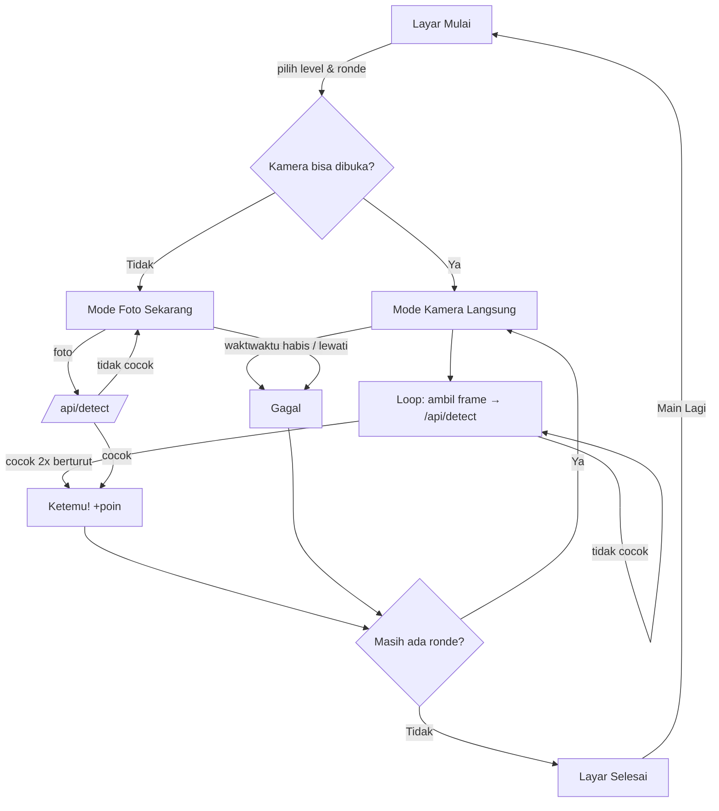

# PRD — Pemburu Benda: Edisi Kampus

| Item | Keterangan |
|---|---|
| Nama produk | Pemburu Benda: Edisi Kampus |
| Versi dokumen | 2.0 |
| Tanggal | 6 November 2026 |
| Pemilik | Alamsyah Sahlan |
| Status | Siap diimplementasikan |
| Repositori | https://github.com/AlamsyahSahlan/pemburu-benda |

---

## 1. Ringkasan

Pemburu Benda adalah game web berbasis kamera untuk **mahasiswa di dalam kelas**. Game memberi tantangan seperti "Cari **LAPTOP + MOUSE** dalam 30 detik!". Pemain lalu mengeluarkan barang dari tas dan mengangkatnya ke depan kamera HP atau laptop. AI **Object Detection** (Telkom AI DAG via Apilogy) mengecek gambar kamera kurang lebih setiap 1 detik. Pemain tidak perlu menekan tombol foto.

Edisi Kampus memakai barang yang **biasa dibawa mahasiswa ke kelas**, misalnya HP, laptop, tumbler, binder, bekal, dan payung. Ada juga level **Nyeleneh** berisi tantangan yang mustahil dibawa ke kelas, seperti kulkas dan "gajah + kulkas". Untuk level ini pemain harus kreatif, misalnya menunjukkan gambar di layar HP teman.

## 2. Latar Belakang & Masalah

- Ice breaking di kelas sering pasif dan kurang interaktif.
- Banyak mahasiswa belum pernah melihat langsung cara memakai **API AI siap pakai** dalam aplikasi nyata.
- Dosen dan pemateri workshop butuh contoh proyek AI yang **kecil, lengkap, dan bisa dibuat dalam satu sesi**.

## 3. Tujuan

| # | Tujuan | Ukuran |
|---|---|---|
| G1 | Membuat suasana kelas aktif dan seru | ≥ 80% peserta ikut bermain minimal 1 ronde |
| G2 | Mengenalkan konsep Object Detection dan label COCO | Peserta bisa menjelaskan arti "label" dan "confidence" |
| G3 | Menunjukkan pola aman memakai API key (proxy backend) | Tidak ada API key yang terlihat di DevTools browser |
| G4 | Bisa dibuat ulang dengan AI coding agent dalam satu prompt | Prompt one-shot menghasilkan game yang langsung jalan |

### Non-tujuan
- Tidak ada login, akun, atau database server.
- Tidak menyimpan foto pemain.
- Tidak ada papan skor online (multiplayer) pada versi ini.

## 4. Pengguna (Persona)

| Persona | Kebutuhan | Kondisi |
|---|---|---|
| **Mahasiswa (pemain)** | Main cepat, seru, dan langsung paham tanpa tutorial panjang | Di kelas, memakai HP sendiri, Wi-Fi kampus atau hotspot |
| **Dosen / Pemateri** | Menyiapkan game di laptop, menampilkannya di proyektor, dan menjelaskan cara kerja AI | Laptop + proyektor, satu API key |
| **Peserta workshop** | Membuat ulang game dengan AI coding agent | Laptop dengan Node.js 20.12+ |

## 5. User Stories

| ID | Sebagai | Saya ingin | Supaya |
|---|---|---|---|
| US-01 | Mahasiswa | Melihat nama barang, emoji, dan petunjuk yang jelas | Saya langsung tahu apa yang harus dicari di tas |
| US-02 | Mahasiswa | Cukup mengangkat barang ke kamera tanpa menekan tombol | Permainan terasa cepat |
| US-03 | Mahasiswa | Melihat barang apa yang dikenali AI kalau tebakan saya salah | Saya tahu harus memperbaiki apa (jarak, sudut, cahaya) |
| US-04 | Mahasiswa | Mendapat skor, bintang, suara, dan konfeti | Saya termotivasi bermain lagi |
| US-05 | Mahasiswa | Memilih level, termasuk level Nyeleneh | Saya bisa memilih tantangan yang lucu |
| US-06 | Mahasiswa | Mengganti kamera depan atau belakang | Saya bisa main sendiri atau berdua |
| US-07 | Mahasiswa | Melewati ronde yang mustahil | Permainan tidak macet |
| US-08 | Dosen | Menjalankan game di laptop dan membuka alamatnya di HP mahasiswa | Satu laptop cukup untuk satu kelas |
| US-09 | Dosen | API key tetap aman di server | Kuota tidak dicuri |
| US-10 | Mahasiswa | Tetap bisa main walau kamera langsung tidak bisa dibuka | Ada mode cadangan "Foto Sekarang" |

## 6. Ruang Lingkup Fitur (MVP)

### F1. Layar Mulai
- Judul "Pemburu Benda", maskot 🕵️, dan kalimat pembuka: "Bongkar tasmu, angkat barangnya ke depan kamera, dan biarkan AI mengecek! 🔍"
- Pilihan level (chip): 🐣 Mudah, 🦊 Sedang, 🦁 Sulit, 🤪 Nyeleneh, 🎲 Campur. Default: Mudah.
- Pilihan jumlah ronde: 3, 5 (default), atau 10.
- Tombol "🚀 Mulai Berburu!". Saat ditekan, kamera dibuka lalu ronde pertama dimulai.

### F2. Layar Main
- HUD: 🎯 ronde ke-n/total, ⏱️ sisa detik, ⭐ skor.
- Progress bar timer yang berubah merah saat sisa waktu ≤ 10 detik, disertai bunyi tik.
- Kartu target berisi "Ayo cari…", emoji besar, NAMA BARANG (huruf kapital), dan 💡 petunjuk.
- Video kamera langsung dengan bingkai pemindai (sudut + garis laser) dan lencana "Angkat benda ke depan kamera".
- Tombol 🔄 untuk mengganti kamera, hanya muncul jika ada lebih dari satu kamera. Pilihan kamera disimpan di `localStorage`.
- Loop deteksi: ambil frame (sisi terpanjang 640 px, JPEG kualitas 0,8), kirim ke `/api/detect`, tunggu 600 ms, lalu ulangi. Hanya ada satu permintaan dalam satu waktu.
- Konfirmasi: target harus terlihat di **2 frame berturut-turut** dengan confidence ≥ 0,5. Setelah frame pertama cocok, tampilkan "👀 Sepertinya ketemu… tahan sebentar!".
- Teks "👀 AI melihat: laptop, botol" berisi label yang diterjemahkan ke Bahasa Indonesia. Label `person` disembunyikan.
- Jika berhasil: tampilkan foto frame terakhir, konfeti, suara menang, dan pesan "🎉 Ketemu! +N".
- Jika waktu habis: suara kalah, efek getar, dan pesan "⏰ Waktu habis!".
- Tombol "Lewati ⏭️" dan "Lanjut ➜" (atau "Lihat Skor 🏆" di ronde terakhir).

### F3. Mode Cadangan "Foto Sekarang"
- Aktif jika `getUserMedia` gagal atau halaman tidak dibuka lewat HTTPS/localhost.
- Tombol "📷 Foto Sekarang" membuka kamera atau galeri bawaan HP (`<input type="file" accept="image/*" capture="environment">`).
- Foto diperkecil (sisi terpanjang 1024 px) lalu dikirim ke AI. **Timer berhenti** selama AI memeriksa.

### F4. Layar Selesai
- 🏆, total skor, 0–3 bintang, dan pesan penyemangat:
  - 3 bintang: semua ronde berhasil, "Pemburu Hebat! 🎉"
  - 2 bintang: minimal setengah berhasil, "Bagus sekali! 👏"
  - 1 bintang: minimal satu berhasil, "Ayo coba lagi! 🙂"
  - 0 bintang: "Jangan menyerah! 💪"
- Daftar ringkasan tiap ronde: emoji, nama, dan +poin atau ❌.
- Tombol "🔁 Main Lagi" untuk kembali ke Layar Mulai.

### F5. Backend Proxy AI
- `POST /api/detect` menerima JPEG mentah (maks 8 MB), meneruskannya ke Apilogy dengan header `x-api-key`, lalu membalas daftar label yang sudah dirapikan.
- Menyajikan file statis dari `public/`.
- HTTPS lokal (opsional) agar kamera bisa dipakai di HP lewat Wi-Fi yang sama.

## 7. Aturan Permainan & Skor

| Aturan | Nilai |
|---|---|
| Durasi per ronde | 30 detik |
| Poin jika berhasil | `100 + 10 × sisa detik` (maks 400) |
| Poin jika gagal atau dilewati | 0 |
| Confidence minimum di klien | 0,5 |
| Confidence minimum di API (`conf_thres`) | 0,45 |
| Frame konfirmasi | 2 berturut-turut |
| Jeda antar-scan | 600 ms + waktu respons API |
| Pengulangan barang | Tidak ada dalam satu permainan (acak tanpa pengembalian) |
| Level Campur | Acak dari semua level, termasuk Nyeleneh |

## 8. Database Barang (Edisi Kampus)

Database disimpan statis di `public/objects.js`. Nilai `label` **wajib** salah satu dari 80 label COCO yang dikenali API.

### Level 1 — Mudah (barang yang hampir pasti ada di tas)

| # | Label API | Nama tampil | Emoji | Petunjuk | Catatan |
|---|---|---|---|---|---|
| 1 | `cell phone` | HP | 📱 | Yang lagi kamu pegang juga boleh 😏 | Pakai HP kedua atau HP teman |
| 2 | `laptop` | Laptop | 💻 | Buka setengah supaya layar & keyboard kelihatan | |
| 3 | `bottle` | Botol Minum | 🧴 | Tumbler, botol air mineral, atau botol teh | `also: ['cup']` karena tumbler sering terbaca *cup* |
| 4 | `book` | Buku / Binder | 📖 | Buku catatan, binder, atau modul kuliah | |
| 5 | `backpack` | Tas Ransel | 🎒 | Angkat tasmu ke depan kamera | |
| 6 | `cup` | Cup Kopi / Gelas | ☕ | Cup kopi, es teh, atau gelas plastik | Alias `wine glass` |
| 7 | `mouse` | Mouse | 🖱️ | Mouse wireless dari tas laptop | |
| 8 | `keyboard` | Keyboard | ⌨️ | Keyboard eksternal atau keyboard laptop | |
| 9 | `handbag` | Tas Selempang / Tote | 👜 | Sling bag, tote bag, atau tas tangan | |
| 10 | `umbrella` | Payung | ☂️ | Payung lipat andalan musim hujan | Lebih mudah terdeteksi jika dibuka |

### Level 2 — Sedang (barang yang tidak dibawa semua orang)

| # | Label API | Nama tampil | Emoji | Petunjuk |
|---|---|---|---|---|
| 1 | `scissors` | Gunting | ✂️ | Sisa tugas maket atau kliping |
| 2 | `spoon` | Sendok | 🥄 | Sendok dari kotak bekal |
| 3 | `fork` | Garpu | 🍴 | Teman si sendok di kotak bekal |
| 4 | `banana` | Pisang | 🍌 | Bekal sehat anak kos |
| 5 | `apple` | Apel | 🍎 | Camilan sehat sebelum kuis |
| 6 | `orange` | Jeruk | 🍊 | Jeruk bekal, jangan dikupas dulu |
| 7 | `sandwich` | Roti Isi | 🥪 | Roti sarapan dari minimarket |
| 8 | `donut` | Donat | 🍩 | Donat titipan teman (jangan dimakan dulu!) |
| 9 | `teddy bear` | Boneka | 🧸 | Boneka kecil atau gantungan kunci boneka |
| 10 | `tie` | Dasi | 👔 | Buat yang habis presentasi atau sidang |
| 11 | `sports ball` | Bola | ⚽ | Anak UKM futsal atau basket pasti bawa |
| 12 | `toothbrush` | Sikat Gigi | 🪥 | Anak kos yang nginep di kampus |
| 13 | `remote` | Pointer / Remot | 🎛️ | Pointer presentasi atau remot AC kelas |
| 14 | `suitcase` | Koper | 🧳 | Yang habis kelas langsung pulang kampung |

### Level 3 — Sulit (2 barang harus terlihat **bersamaan** di satu frame)

| # | Label API (`all`) | Nama tampil | Emoji | Petunjuk |
|---|---|---|---|---|
| 1 | `laptop` + `mouse` | Laptop + Mouse | 💻🖱️ | Setup nugas lengkap |
| 2 | `laptop` + `cell phone` | Laptop + HP | 💻📱 | Multitasking: Zoom sambil balas grup |
| 3 | `laptop` + `cup` | Laptop + Kopi | 💻☕ | Nugas ala anak kafe |
| 4 | `laptop` + `book` | Laptop + Buku | 💻📖 | Belajar hybrid |
| 5 | `book` + `bottle` | Buku + Botol | 📖🧴 | Siap kuliah pagi |
| 6 | `backpack` + `umbrella` | Ransel + Payung | 🎒☂️ | Siap menembus hujan ke kampus |
| 7 | `banana` + `bottle` | Pisang + Botol | 🍌🧴 | Bekal hemat akhir bulan |
| 8 | `spoon` + `fork` | Sendok + Garpu | 🥄🍴 | Alat makan bekal |
| 9 | `sandwich` + `cup` | Roti + Kopi | 🥪☕ | Sarapan sambil kelas pagi |
| 10 | `book` + `scissors` | Buku + Gunting | 📖✂️ | Tugas kliping dadakan |

### Level 4 — 🤪 Nyeleneh (mustahil dibawa ke kelas)

| # | Label API | Nama tampil | Emoji | Petunjuk | Kenapa lucu |
|---|---|---|---|---|---|
| 1 | `refrigerator` | Kulkas | 🧊 | Bawa kulkas ke kelas?! 😱 Gambar kulkas di layar HP teman juga dihitung | Tidak ada yang bawa kulkas ke kelas. Pemain akan berlomba mencari gambar kulkas di Google lalu menyodorkan layar HP ke kamera. Ini juga membuktikan bahwa AI mengenali **gambar di layar**, bukan hanya benda asli. |
| 2 | `elephant` + `refrigerator` | Gajah + Kulkas | 🐘🧊 | Teka-teki klasik: gimana masukin gajah ke kulkas? Tunjukkan dua-duanya sekaligus! 🤣 | Mengangkat teka-teki receh "cara memasukkan gajah ke kulkas". Pemain harus menampilkan gambar gajah dan kulkas di dua HP sekaligus atau satu gambar berisi keduanya. Cocok untuk kerja sama tim. |

> **Catatan fasilitator:** Level Nyeleneh sengaja dibuat untuk memancing diskusi, misalnya "Kenapa AI tetap mengenali kulkas walaupun hanya foto?" Jawabannya: model hanya melihat piksel dan tidak tahu benda itu asli atau gambar.

### Alias & Terjemahan
- `ALIASES = { cup: ['cup', 'wine glass'] }`
- `LABEL_ID` berisi terjemahan Bahasa Indonesia untuk ke-80 label COCO, dipakai di teks "AI melihat".

### Skema data satu target

```js
{
  label?: string,     // satu label COCO (untuk target tunggal)
  all?:   string[],   // beberapa label yang harus terlihat bersamaan (level 3 & 4 kombinasi)
  also?:  string[],   // label lain yang juga diterima
  name:   string,     // nama tampil (Bahasa Indonesia)
  emoji:  string,
  hint:   string,
  level:  1 | 2 | 3 | 4
}
```

## 9. Integrasi AI

| Item | Nilai |
|---|---|
| Penyedia | Telkom AI DAG — Object Detection v0.0.2 (Apilogy, Free Plan) |
| Endpoint | `POST https://telkom-ai-dag.api.apilogy.id/Object_Detection/0.0.2/images/detect_objects` |
| Header | `x-api-key: <APILOGY_API_KEY>`, `Accept: application/json` |
| Body | `multipart/form-data`, field `file` berisi gambar JPEG |
| Query | `conf_thres=0.45` |
| Contoh respons | `{"data":[{"laptop":{"bbox":[x1,y1,x2,y2],"conf_score":0.93}}]}` |
| Batas waktu | 20 detik |

Parser respons harus **fleksibel**: label bisa berupa key objek atau field `label/name/class/class_name/object/category`, sedangkan confidence bisa berupa `conf_score/confidence/score/conf/probability/prob`. Hanya label yang termasuk 80 label COCO yang diambil, dan confidence tertinggi per label yang disimpan.

## 10. Kebutuhan Non-Fungsional

| Kategori | Kebutuhan |
|---|---|
| Keamanan | API key hanya ada di `.env` server dan tidak pernah dikirim ke browser. Path traversal dicegah. Upload dibatasi 8 MB. `.env` dan `certs/` masuk `.gitignore`. |
| Privasi | Foto tidak disimpan di disk maupun log. Frame hanya diteruskan ke API lalu dibuang. |
| Performa | Respons deteksi < 2 detik (p50). Frame diperkecil ke 640 px agar hemat kuota dan bandwidth. |
| Kompatibilitas | Chrome/Edge/Safari terbaru di Android, iOS, Windows, dan macOS. |
| Aksesibilitas | Teks besar, kontras tinggi, emoji sebagai petunjuk visual, dan menghormati `prefers-reduced-motion`. |
| Ketergantungan | **Nol dependency npm.** Hanya Node.js 20.12+ (memakai `fetch`, `FormData`, `Blob`, `process.loadEnvFile`). |
| Bahasa | Seluruh UI dan pesan error dalam Bahasa Indonesia yang santai. |

### Pesan Error

| Kondisi | Pesan |
|---|---|
| API key kosong | `APILOGY_API_KEY belum diisi di file .env` |
| 401/403 | `API key ditolak. Cek APILOGY_API_KEY dan pastikan sudah subscribe Object Detection.` |
| 429 | `Terlalu banyak foto, tunggu sebentar ya.` |
| Timeout | `AI terlalu lama menjawab, coba lagi` |
| Foto > 8 MB | `Foto terlalu besar` |

## 11. Alur Pengguna



## 12. Metrik Keberhasilan

- Barang level Mudah terdeteksi dalam < 5 detik pada cahaya kelas normal.
- ≥ 70% ronde level Mudah berhasil diselesaikan.
- 0 kebocoran API key (cek tab Network di DevTools).
- Prompt one-shot menghasilkan game yang langsung jalan dengan `npm start` tanpa perbaikan manual.

## 13. Risiko & Mitigasi

| Risiko | Dampak | Mitigasi |
|---|---|---|
| Cahaya kelas redup atau barang terlalu jauh | Deteksi gagal | Petunjuk jarak 30–60 cm, teks "AI melihat" sebagai umpan balik |
| Kamera HP diblokir karena bukan HTTPS | Tidak bisa main | `npm run cert` + HTTPS lokal, mode Foto Sekarang |
| Kuota atau rate limit API (429) | Scan berhenti | Pesan ramah + jeda 2 detik sebelum coba lagi |
| Wi-Fi kampus memblokir antarperangkat (client isolation) | HP tidak bisa membuka laptop | Pakai hotspot HP dosen |
| Satu kelas memakai satu API key | Rate limit cepat tercapai | Main bergiliran per kelompok, kurangi jumlah HP yang scan bersamaan |
| Label `person` selalu muncul | Membingungkan | Disembunyikan dari teks "AI melihat" |

## 14. Rencana Rilis

| Fase | Isi |
|---|---|
| v1.0 (sudah ada) | Edisi Rumah untuk anak |
| **v2.0 (dokumen ini)** | Edisi Kampus + level Nyeleneh |
| v2.1 (ide) | Papan skor kelas, mode tim, timer bisa diatur, suara nama barang (TTS) |

## 15. Lampiran
- Detail teknis: [IMPLEMENTATION.md](IMPLEMENTATION.md)
- Prompt satu kali generate: [PROMPT-ONE-SHOT.md](PROMPT-ONE-SHOT.md)
